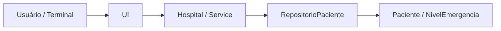

<div align="center">
  
</div>

<div align="center">

# G E S T Ã O　H O S P I T A L A R

### `JAVA • RECORDS • STREAMS • CONSOLE`

**Aplicação Java de console para registrar pacientes e produzir consultas de triagem, busca e indicadores com orientação a objetos e programação funcional.**


`GILBERTO CORRÊA` · `SOFTWARE ENGINEERING` · `PROJECT DOCUMENTATION`

[Visão geral](#visao-geral) · [Recursos](#recursos) · [Arquitetura](#arquitetura) · [Execução](#execucao)

</div>

---

<a id="visao-geral"></a>

## `PROJECT // VISÃO GERAL`

Aplicação Java de console para registrar pacientes e produzir consultas de triagem, busca e indicadores com orientação a objetos e programação funcional.

<a id="recursos"></a>

## `SYSTEM // INVENTÁRIO`

| Recurso | Situação |
| :--- | :--- |
| Admissão de pacientes | `Presente` |
| Triagem de urgentes e críticos | `Presente` |
| Média de idade e total de segurados | `Presente` |
| Busca por nome e paciente mais idoso | `Presente` |

## `STRUCTURE // ORGANIZAÇÃO`

- `src/Main.java` — inicialização
- `src/model/` — `Paciente` e `NivelEmergencia`
- `src/Repositorio/RepositorioPaciente.java` — armazenamento
- `src/Service/Hospital.java` — operações
- `src/UI/` — interação via terminal

<a id="arquitetura"></a>

## `ARCHITECTURE // FLUXO DO PROJETO`



<a id="execucao"></a>

## `BOOT SEQUENCE // EXECUÇÃO OU UTILIZAÇÃO`

```bash
git clone https://github.com/gilbertocorrea-cmd/gestao-hospitalar.git
cd gestao-hospitalar
```

O README original orienta JDK 17+ e a seguinte sequência na raiz: `mkdir -p out`, `javac -d out $(find src -name "*.java")` e `java -cp out src.Main`. A aplicação é de terminal, sem API web ou persistência em banco.

---

## `DOCUMENTATION // REFERÊNCIA TÉCNICA ORIGINAL`

informações básicas de um hospital.

## Integrante

- Gilberto Antonio Corrêa Filho

## Funcionalidades

O menu permite:

1. admitir um paciente;
2. listar pacientes urgentes e críticos;
3. mostrar a média de idade dos casos críticos e o total de segurados;
4. encontrar o paciente mais idoso;
5. encerrar o programa;
6. buscar um paciente pelo nome como funcionalidade extra.

## Organização


src/
├── Main.java
├── GestorHospitalar.java
├── model/
│   ├── Paciente.java
│   └── NivelEmergencia.java
├── Repositorio/
│   └── RepositorioPaciente.java
├── Service/
│   └── Hospital.java
└── UI/
    ├── UiDeUsuario.java
    └── UiOperacoesHospital.java


Cada parte possui uma responsabilidade:

- `Paciente` e `NivelEmergencia` representam os dados.
- `RepositorioPaciente` guarda e recupera os pacientes.
- `Hospital` contém filtros, buscas, contagens e cálculos.
- `UiDeUsuario` controla o menu.
- `UiOperacoesHospital` recebe dados e apresenta resultados.
- `Main` cria os objetos e inicia o sistema.
- `GestorHospitalar` oferece o console interativo pedido no enunciado.

O caminho normal de uma operação é:

Usuário → UI → Hospital → Repositório


## Conceitos utilizados

- `record`: representa os dados imutáveis de um paciente.
- `enum`: limita os níveis de emergência às opções permitidas.
- `Stream`: filtra, transforma e consulta a lista de pacientes.
- `Optional`: representa um paciente que pode ou não ser encontrado.
- `OptionalDouble`: representa uma média que pode não existir.
- Switch Expression: escolhe uma ação e devolve um resultado.
- `yield`: devolve o resultado de um bloco dentro da Switch Expression.

No menu, `yield true` faz o programa continuar e `yield false` encerra a
repetição.

## Principais dificuldades

- Validar corretamente valores dos tipos `String`, `int` e `boolean`.
- Entender que tipos primitivos, como `int` e `boolean`, não podem receber
  `null`, além da diferença entre `boolean` e a classe `Boolean`.
- Criar e organizar as validações dentro do construtor compacto do `record
  Paciente`.
- Entender quando usar `IllegalArgumentException` para representar dados
  inválidos.
- Criar o `enum NivelEmergencia` e converter a opção numérica informada pelo usuário para um dos níveis disponíveis.
- Impedir que uma idade inválida ou maior que 150 anos fosse aceita durante a admissão.
- Entender o funcionamento de uma Switch Expression e do comando `yield`, usado para devolver o resultado de cada bloco do `switch`.
- Utilizar Streams para filtrar somente pacientes urgentes e críticos.
- Ordenar os pacientes emergenciais por idade em ordem decrescente.
- Calcular a média das idades com `mapToInt` e `average`.
- Encontrar o paciente mais idoso usando `max` e `Comparator`.
- Contar pacientes segurados usando `filter` e `count`.
- Entender e utilizar Method References, como `Paciente::idade` e
  `Paciente::possuiPlano`.
- Tratar resultados que podem não existir. A solução foi utilizar `Optional`, `OptionalDouble` e `ifPresentOrElse`, evitando retornos nulos.
- Fazer a triagem mostrar todos os pacientes urgentes e críticos, na ordem correta, em vez de apresentar somente um resultado.
- Separar armazenamento, regras de negócio e interação com o usuário. A solução foi dividir o projeto entre repositório, serviço e classes de UI.
- Manter a classe `Main` limpa, deixando nela somente a criação e conexão dos objetos necessários para iniciar o sistema.
- Dividir a interface entre o controle do menu e a execução das operações do hospital.
- Compartilhar o mesmo objeto `Scanner` entre as classes de interface, evitando conflitos na leitura do teclado.
- Organizar os pacotes e entender por que a pasta `src` aparecia no nome do `package` dentro da configuração atual do projeto.
- Corrigir imports, nomes de métodos, referências de métodos e pequenos erros de digitação que impediam a compilação.
- Entender que arquivos `.class` são gerados pela compilação e não devem ser editados diretamente.
- Ajustar os nomes dos métodos, a ordem dos atributos, o menu e a classe `GestorHospitalar` para manter compatibilidade com o enunciado.
- Documentar o código de maneira simples e didática.
- Aprender a a utilizar VSCode de forma profissional e operacional.

## Executar

Requer JDK 17 ou superior. Na raiz do projeto:

```sh
mkdir -p out
javac -d out $(find src -name "*.java")
java -cp out src.Main
```

---

<div align="center">

## `GESTAO HOSPITALAR // BUILD • LEARN • EVOLVE`

**Gilberto Corrêa**

[GitHub](https://github.com/gilbertocorrea-cmd)

</div>
